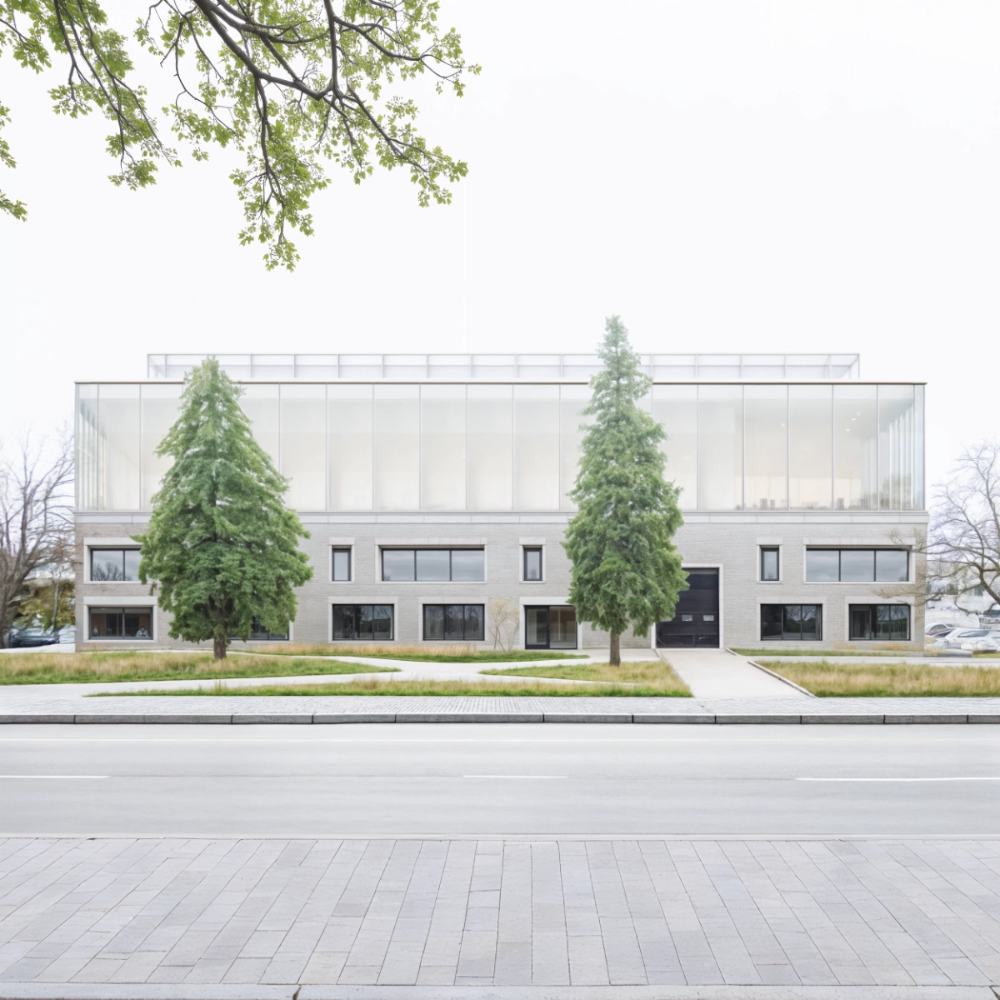
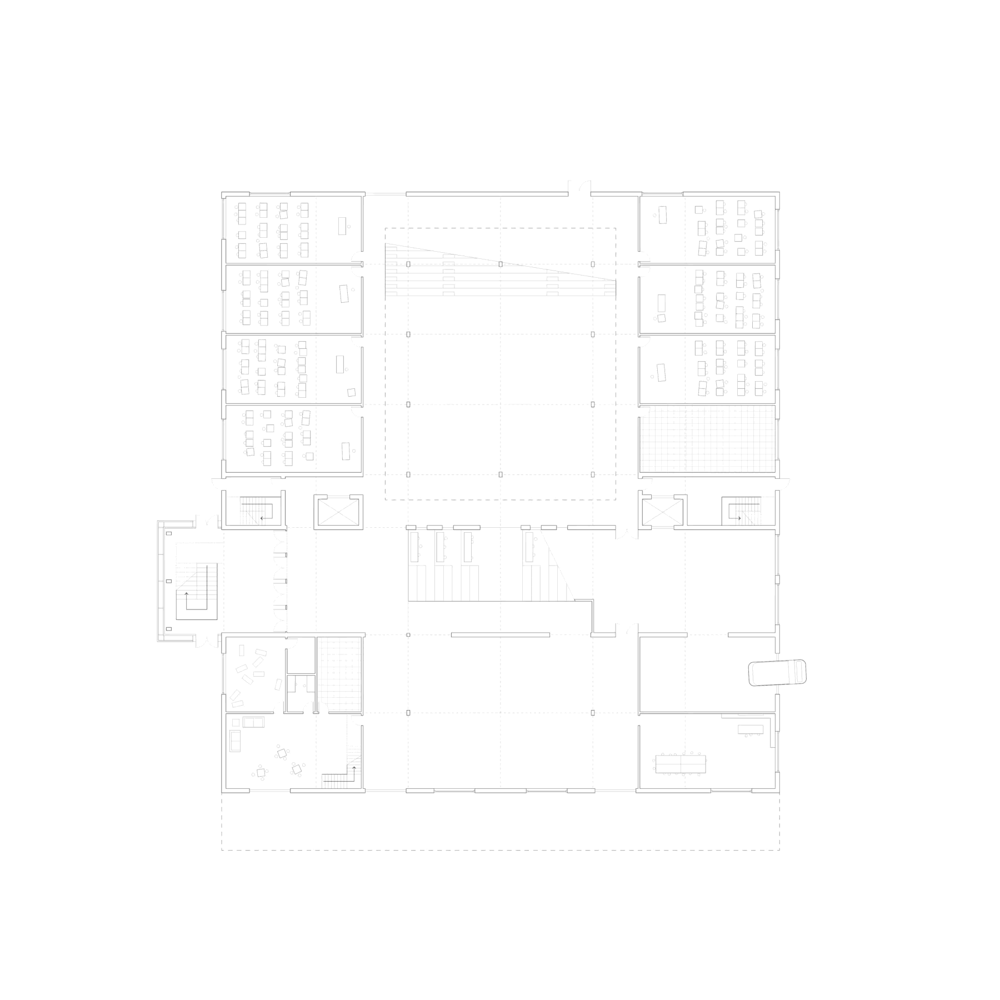
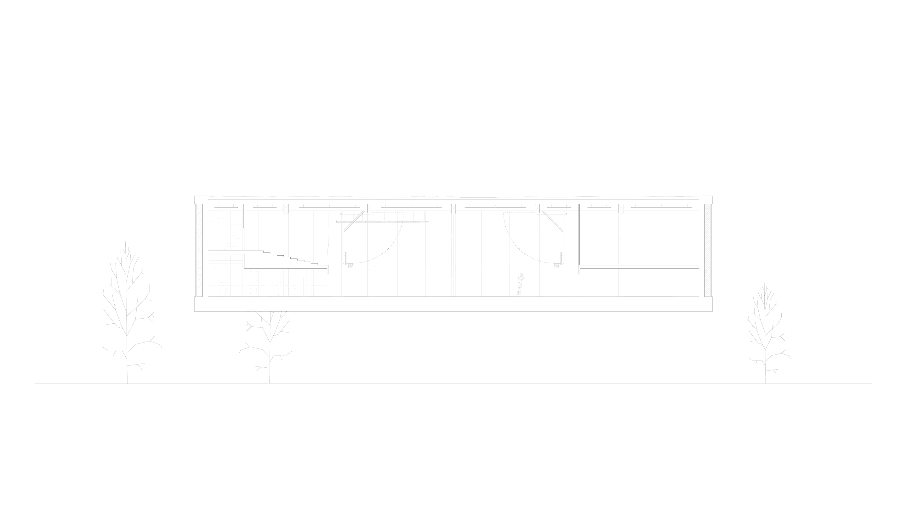
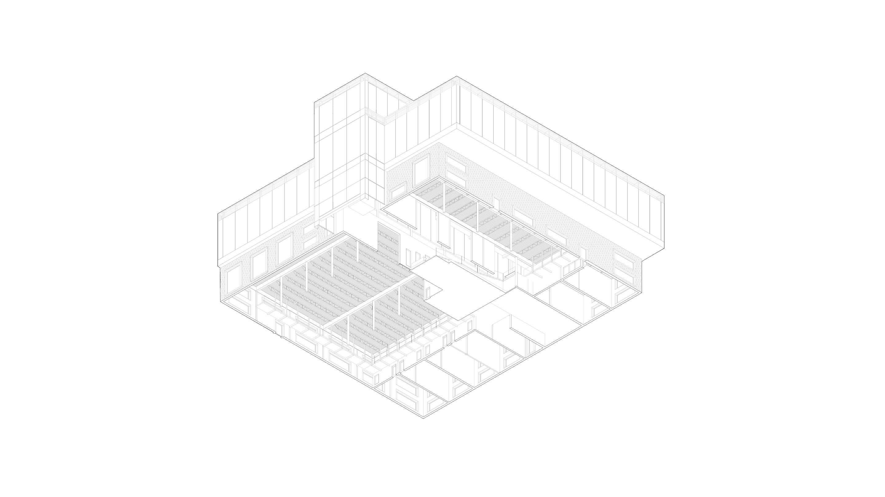
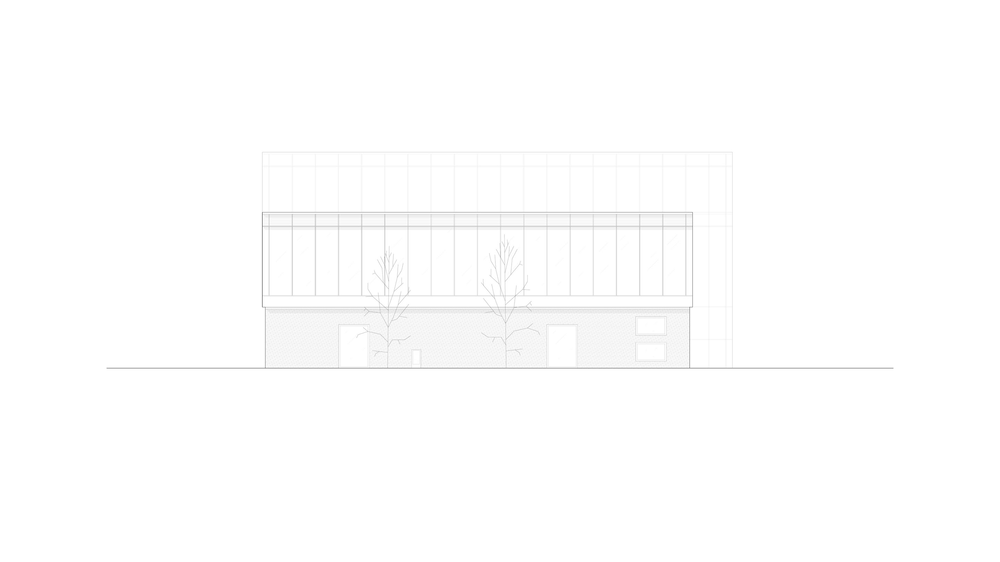
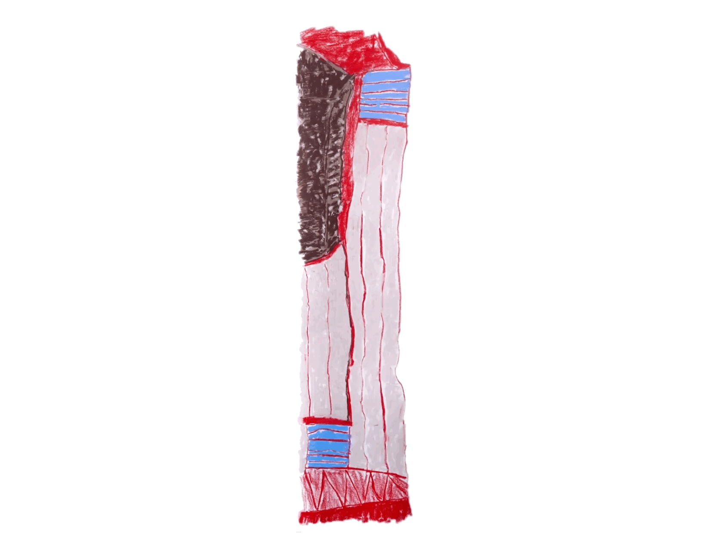
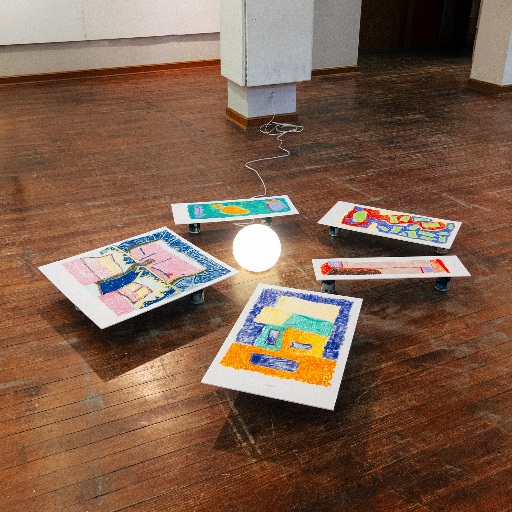

# Adaptive Reuse Mosque

This adaptive reuse mosque, a master’s project at McGill University, transforms an existing industrial steel and masonry building in Montreal North into a mosque and community centre for marginalized populations. The design prioritizes the reuse of the existing structure while simultaneously creating functional spaces for spiritual and community activities. Unused industrial parking areas on-site are transformed into the sole green space in the neighbourhood. Furthermore, materials with a focus on carbon-neutrality, such as locally sourced wood and rammed earth Trombe walls are employed, providing passive solar heating gains and ventilation that enhances durability and energy efficiency. 

Additionally, a series of hand-drawn hybrid drawing were produced to encapture both the technical and the conceptual components of the design process.

