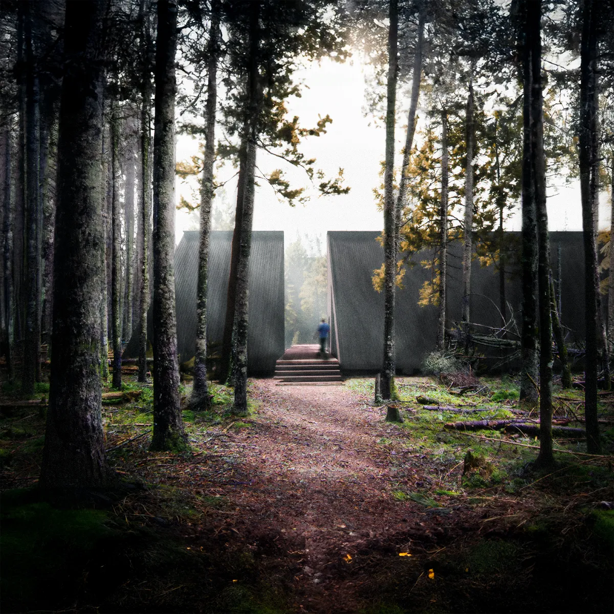

# Dans'l bois

In order to combat the housing crisis in Quebec, and to enable younger people to become homeowners despite an economy that makes this difficult, the Quebec government's selection program offers unused land within its territory to citizens by drawing lots. The aim of the following project is to propose a strategy for exploiting such land. Using on-site resources is the most ecological and viable solution, particularly given the distances involved in accessing the land. A mobile sawmill enables all the necessary cuts to be made, optimizing the use of available timber sections. Round timber is prioritized, as it is 2.5x stronger than machined timber and requires less cutting and energy. However, cleaning, flattening and joint cutting are still essential. The planks and lines of wood resulting from these cuts are used for cladding, flooring and tertiary structures, enabling full use to be made of the available trunks. Façade wood is burned in a fire fed by the unused logs left over from the cutting process, to protect the wood exposed to the outside from pests, beasts and the elements. Insulation and windows are the only elements not made of wood cut on site. The result is a building with 95% wood cut on site, offering a home with studied and optimized spaces, while respecting the minimum budget imposed by the government.

Supervised by [Yves Weinand](https://people.epfl.ch/yves.weinand?lang=fr) (Prof., PhD.) and assisted by [Agathe Mignon](https://www.google.com/url?sa=t&source=web&rct=j&opi=89978449&url=https://people.epfl.ch/agathe.mignon%3Flang%3Dfr&ved=2ahUKEwj19I7P_-SXAxUAtokEHXo6FoUQFnoECBcQAQ&usg=AOvVaw2iQwb-8Yv_xf_q02ylnixY) (Assist,. PhD.), [Studio Weinand](https://www.epfl.ch/labs/ibois/teaching-2/studio-weinand/reinvent-log-architecture-autumn-2023/) stands at the intersection of engineering and architecture to study wood, from territory to material. In the first phase of the semester, students undertook research into log architecture, seeking to integrate raw wood production into the construction process to solve its challenges. The second phase was devoted to the creation of 1:1 scale model details, highlighting the ecological advantages of wood while minimizing the transport and transformation required.

A detailed archives of this project lives on École Polytechnique Fédérale de Lausanne's [Living Archives](https://livingarchives.epfl.ch/projects/6017/dansl-bois/) website.

(more images coming soon)

---

### Prix de la Fondation Habitat 67

This project was awarded the Prix de la Fondation Habitat 67, given to a studio project that demonstrates excellence in housing design.