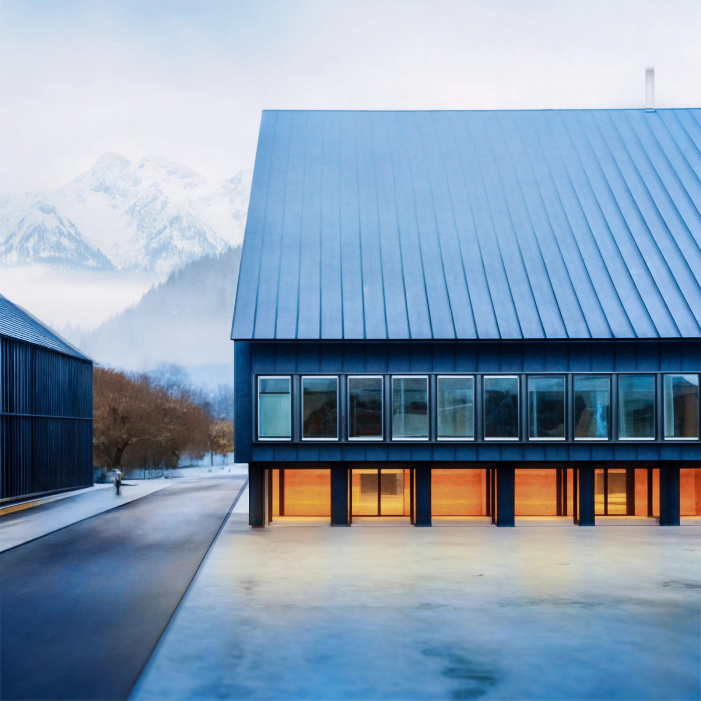

# Duramen

Duramen, a collaborative studio project at [Laboratory for Timber Constructions IBOIS](https://www.epfl.ch/labs/ibois/teaching-2/studio-weinand/a-multi-purpose-log-building-spring-24/) at EPFL, dedicated to designing a multi-purpose log building for the future Haute École du Bois et de la Forêt (HEBF) campus in the French Alps. Located in a former industrial zone, the project aims to integrate raw round wood and ‘’zero-use’’ timber into an innovative structural proposal for Argentière-la-Bessée. We then designed and constructed a 1:1 prototype, demonstrating key construction details in raw round wood. 

Duramen was subsequent of [Dans'l bois](../dans-l-bois/dans-l-bois.md), another semester project in the Studio Weinand.

A detailed archives of this project lives on École Polytechnique Fédérale de Lausanne's [Living Archives](https://livingarchives.epfl.ch/projects/?author=8886&project=6207) website.

(more images coming soon)

---

### Prix de la BCV

This project was awarded the Prix de la Fondation BCV 2024, given to the best studio work of the section d’architecture of the semester.