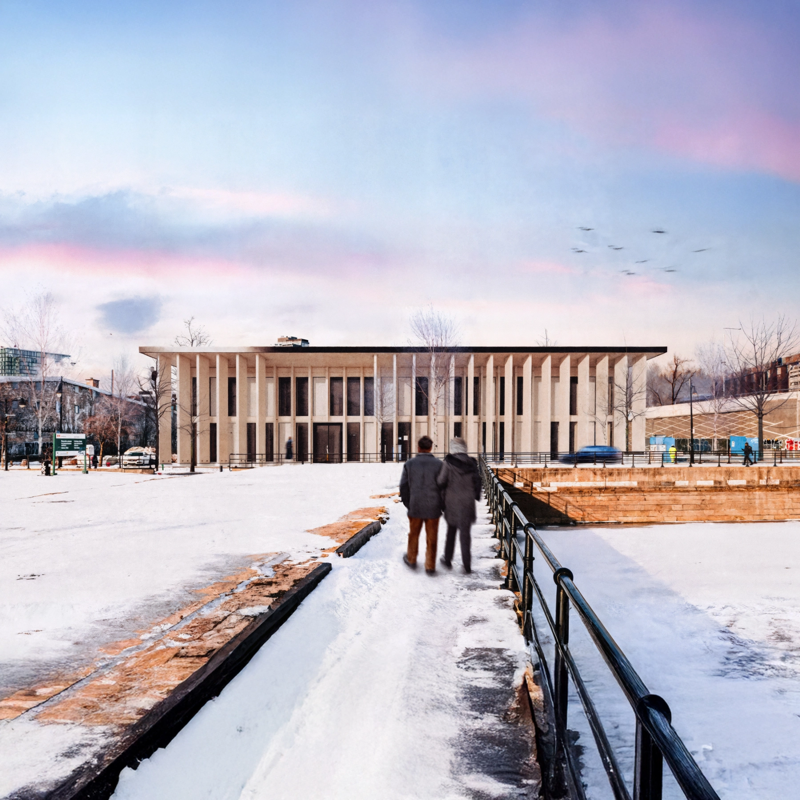

# Maison du livre

Maison du livre, a collaborative studio project during the second year of architecture. The Maison du livre is an institutional library within a mass timber structure exhibiting both foundational research on wood construction and conceptual refinement of essential social spaces for Montréal’s Old Port.

