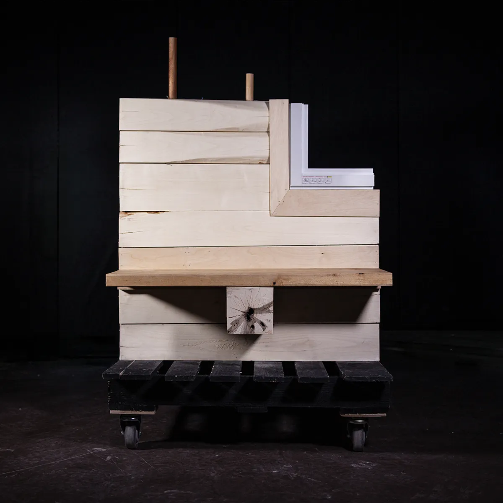

Prototyping Forest Resilience, my final M.Arch. project at McGill University, operates from one premise: “Every timber specification is a silvicultural prescription.” SPF dependence in construction embeds monoculture in planted forests as climate change restructures Quebec's species composition and pushes tree species northward. 

Through a trait-based filter, Quebec species are systematically assessed, assemblies iterated, and one envelope developed into a 1:1 wall prototype. A Norway maple, an invasive species compression wall with yellow birch dowels and compressed straw insulation surpasses Passive House requirements, is a net carbon sink, and employs undervalued hardwood species.

(more images coming soon)

---

### A.F. Dunlop Scholarship 

Travelling scholarship bequeathed in 1937 by the late Mrs. Catherine A. Dunlop. Administered by the McGill School of Architecture. 

### Honourable Mention, AIA Canada Society 

*"Prototyping Forest Resilience is recognized for bridging architectural practice with material resource stewardship. By looking beyond conventional and often unconsidered supply chains, the project creates an analytical framework that identifies lesser-used hardwood species for new design possibilities. Through extensive research, prototyping and cataloguing, the project demonstrates how architecture can transform the construction industry by determining a regenerative building sector."* — AIA Canada Society, Canadian Architect

### Seymour & Shirley Levine Prize in Design 

Established in 2000 by friends and family of Seymour and Shirley Levine. The prize is awarded by the School of Architecture to a graduating student who has demonstrated excellence and innovation in the integration of environmental systems in the final project of the Professional M. Arch. program. 