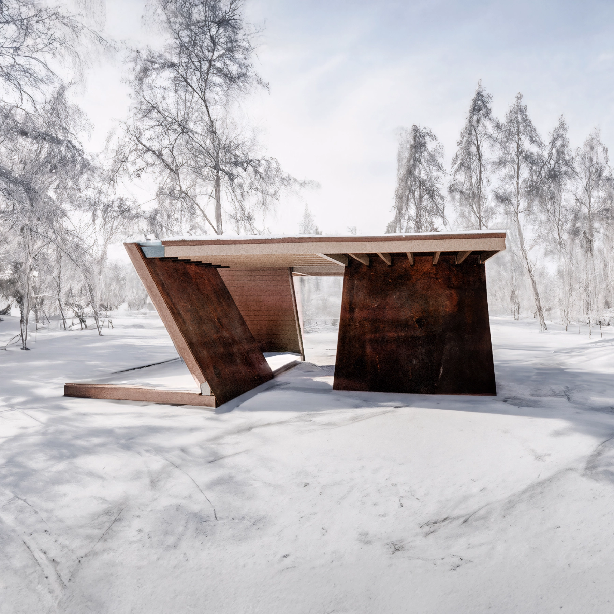
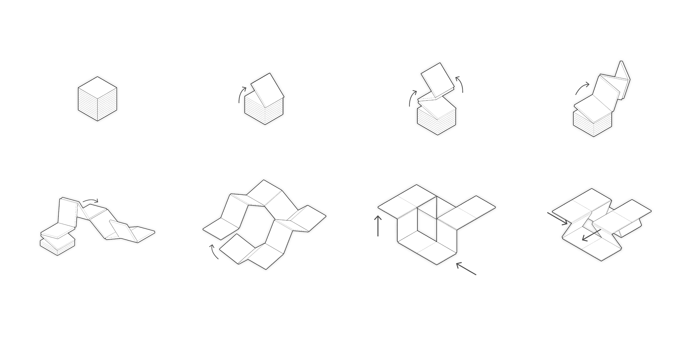

# La boîte

La boîte, a semester project as a first encounter with architecture during my first year at Université de Montréal in 2021. This first project aims to propose a simple, yet dynamic structure that unfolds from a 2.4m wide cube. As part of the final project in construction class, a more technically defined and constructed was developed.

(more images coming soon)

